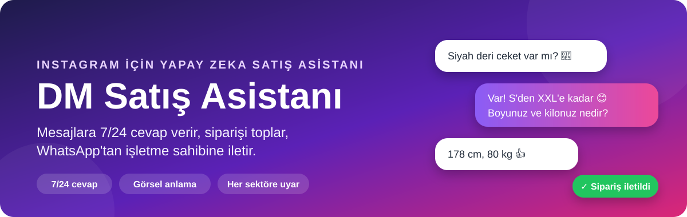
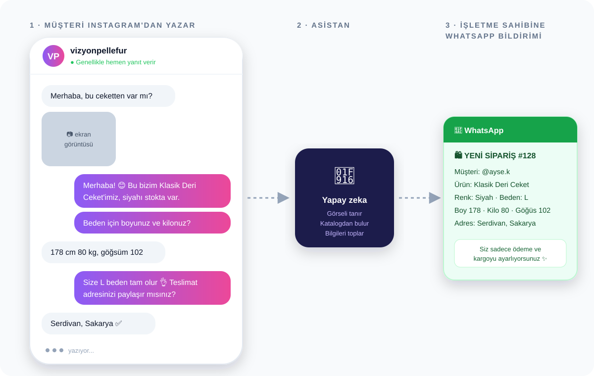
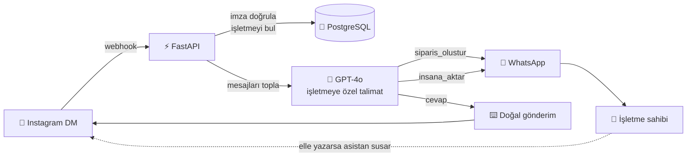
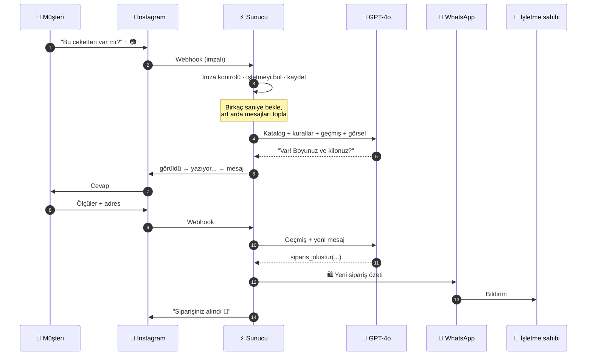
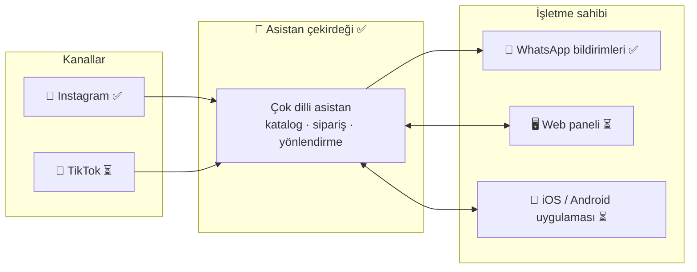

<p align="center">
  
</p>

<p align="center">
  <a href="https://github.com/numanak-b221210105/dm-satis-asistani/actions/workflows/tests.yml"></a>
  
  
  
  
  
  
</p>

<p align="center">
  <b>Instagram'dan satış yapan işletmeler için yapay zeka destekli DM satış asistanı.</b><br>
  Müşteriye kendi dilinde, işletmenin kataloğuyla cevap verir; sipariş bilgilerini toplar ve siparişi WhatsApp'tan işletme sahibine iletir.
</p>

<p align="center">
  <a href="#nasil">Nasıl çalışır?</a> •
  <a href="#ozellikler">Özellikler</a> •
  <a href="#sektorler">Sektörler</a> •
  <a href="#mimari">Mimari</a> •
  <a href="#kurulum">Kurulum</a> •
  <a href="#urun">Ürün vizyonu</a> •
  <a href="#yol-haritasi">Yol haritası</a>
</p>

---

## 🎯 Problem

Instagram'dan satış yapan bir işletmenin DM kutusu her gün aynı sorularla doluyor:

> *"Fiyatı ne kadar?"* · *"Bedeni var mı?"* · *"Kargo kaç gün?"* · *"Bu ürün sizde var mı?"* 📷

Cevap birkaç saat gecikirse müşteri başka bir hesaptan alışverişini yapıyor. İşletme sahibi ise gününün büyük kısmını
satış yapmak yerine mesaj yazarak geçiriyor.

## 💡 Çözüm

**DM Satış Asistanı** işletmenin Instagram hesabına bağlanıyor ve bir satış danışmanı gibi çalışıyor:

<p align="center">
  
</p>

<a id="nasil"></a>

## ⚙️ Nasıl çalışır?

| | Adım | Ne oluyor? |
|:-:|---|---|
| **1** | 💬 **Müşteri yazar** | Instagram DM'den bir soru, ürün fotoğrafı ya da sesli mesaj gelir. |
| **2** | 🧠 **Asistan anlar** | Mesajı okur, fotoğraftaki ürünü tanır, işletmenin kataloğundan en uygun ürünü bulur. |
| **3** | 📝 **Bilgileri toplar** | İşletmenin belirlediği bilgileri (beden, adres, tarih...) doğal bir sohbet içinde sorar. |
| **4** | 📲 **Siparişi iletir** | Sipariş tamamlanınca işletme sahibine WhatsApp'tan hazır bir sipariş özeti gönderir. |
| **5** | 🙋 **Gerektiğinde satıcıya bırakır** | Özel ölçü, pazarlık gibi satıcının kararı gereken konularda müşteriyi hazır mesajla WhatsApp'a yönlendirir. Şikayet ya da iade gelirse sohbeti işletme sahibine bırakıp susar. |

> 🌍 Müşteri hangi dilde yazarsa asistan o dilde cevap veriyor. İşletme sahibine giden özetler ise her zaman sahibinin kendi dilinde.

<a id="ozellikler"></a>

## ✨ Özellikler

<table>
<tr>
<td width="50%" valign="top">

### 📸 Görsel anlama
Müşteri ürünün ekran görüntüsünü attığında GPT-4o görseli inceliyor ve katalogdaki en yakın ürünü buluyor.

</td>
<td width="50%" valign="top">

### 🛡️ Uydurmuyor
Yalnızca katalogdaki ürünleri ve işletmenin yazdığı kuralları kullanıyor. Bilmediği bir şeyi tahmin etmiyor, işletme sahibine soruyor.

</td>
</tr>
<tr>
<td valign="top">

### 🤝 İşletme sahibi devreye girince susar
İşletme sahibi Instagram'dan müşteriye kendisi yazdığında asistan bunu fark edip o sohbetten çekiliyor.

</td>
<td valign="top">

### 💬 Art arda mesajlara tek cevap
*"selam"* · *"ceket var mı"* · *"siyah"* gibi peş peşe gelen mesajları bekleyip hepsine tek, toplu bir cevap veriyor.

</td>
</tr>
<tr>
<td valign="top">

### ⌨️ Doğal sohbet akışı
Mesajı görüldü olarak işaretliyor, cevap gönderilene kadar *"yazıyor..."* gösteriyor, uzun cevapları cümle sonlarından ikiye bölüyor.

</td>
<td valign="top">

### 🏪 Birden fazla işletme
Tek kurulum birçok işletmeye hizmet veriyor. Her işletmenin kataloğu, üslubu, kuralları ve bildirim numarası ayrı.

</td>
</tr>
<tr>
<td valign="top">

### 🌍 Çok dilli
Müşteriye kendi dilinde cevap veriyor (Türkçe, İngilizce, Sırpça, Romence, Hırvatça ve 11 dil daha). Sırpçada müşterinin kullandığı alfabeyi (Latin/Kiril) koruyor. İşletme sahibine bildirimler ise kendi dilinde, müşterinin dili belirtilerek gidiyor.

</td>
<td valign="top">

### 🔐 Güvenlik
Instagram token'ları şifreli saklanıyor, webhook imzası doğrulanıyor, aynı mesaj iki kez gelirse bir kez işleniyor.

</td>
</tr>
<tr>
<td valign="top">

### 🔄 Kendi bakımını yapar
Instagram bağlantısını 60 günde bir otomatik yeniliyor. Her işletmenin yapay zeka kullanımını ve maliyetini kaydediyor.

</td>
<td valign="top">

### 🧾 Hazır sipariş özeti
Sipariş tamamlanınca işletme sahibine ürün, müşteri bilgileri, müşterinin dili ve kısa bir not içeren düzenli bir özet gidiyor.

</td>
</tr>
<tr>
<td valign="top">

### 📲 WhatsApp'a köprü
Sipariş oluşunca müşteriye, sipariş bilgileri yazılmış hazır bir WhatsApp linki veriliyor. Özel ölçü, pazarlık ya da toptan gibi satıcının kararı gereken konularda müşteri, mesajı kendi dilinde hazırlanmış bir linkle satıcının WhatsApp hattına yönlendiriliyor.

</td>
<td valign="top">

### 🧭 Kurulum sihirbazı
İşletme sahibine sektör, diller, para birimi (EUR, USD, TRY...), kargo/iade şartları ve WhatsApp numaraları soruluyor. Asistan cevaplara göre kendini ayarlıyor; sektöre uygun sipariş alanları otomatik geliyor.

</td>
</tr>
</table>

<a id="sektorler"></a>

## 🧩 Her sektöre uyar

Siparişte hangi bilgilerin sorulacağına işletme karar veriyor; asistan sohbeti buna göre yürütüyor.

| İşletme | Asistanın topladığı bilgiler |
|---|---|
| 🧥 **Giyim butiği** | Boy · kilo · göğüs ölçüsü · renk · adres |
| 🎂 **Pastane** | Teslim tarihi · kişi sayısı · pasta üzerine yazı · adres |
| 💇 **Kuaför / güzellik salonu** | Hizmet · tarih ve saat · ad soyad · telefon |
| 🕯️ **El yapımı ürünler** | Renk · kişiselleştirme notu · adet · adres |
| 🏠 **Ev tekstili** | Ölçüler (en × boy) · desen · adet · adres |

<a id="mimari"></a>

## 🏗️ Mimari



<details>
<summary><b>📨 Bir mesajın yolculuğu (sequence diagram)</b></summary>



</details>

<details>
<summary><b>📁 Proje yapısı</b></summary>

```
app/
├── main.py          Webhook, işletme yönlendirmesi, mesaj toplama, echo algılama
├── agent.py         Asistan döngüsü, dinamik araç şemaları, görsel desteği, kullanım kaydı
├── prompts.py       İşletmeye özel talimat (katalog + kurallar + sipariş alanları)
├── humanizer.py     Yazıyor göstergesi, bekleme, mesaj bölme
├── meta.py          Instagram API · WhatsApp Cloud API · imza doğrulama
├── admin.py         Yönetim API'si: işletmeler, ürünler, siparişler, sohbetler, kullanım
├── maintenance.py   Periyodik token yenileme
├── onboarding.py    Kurulum sihirbazı soruları ve sektör şablonları
├── languages.py     Desteklenen diller ve yedek mesaj çevirileri
├── currencies.py    Para birimleri ve fiyat gösterimi
├── whatsapp_link.py Müşteri için hazır mesajlı wa.me bağlantıları
├── crypto.py        Token şifreleme (Fernet)
└── db.py            SQLAlchemy 2 (async) modelleri
migrations/          Alembic şema geçişleri
tests/               Uçtan uca testler (Meta ve OpenAI taklit edilerek)
docs/                README görselleri
```

</details>

<details>
<summary><b>🔧 Teknik kararlar</b></summary>

- **Debounce + sohbet başına kilit:** Peş peşe gelen mesajlar tek cevapta birleştiriliyor. Kilit sayesinde
  botun kendi gönderdiği mesajın echo'su, mesajın ID'si kaydedilmeden önce işlenmiyor; böylece bot kendi
  mesajını işletme sahibininki sanıp susmuyor.
- **Dinamik araç şeması:** `siparis_olustur` aracının parametreleri her işletmenin `order_fields` ayarından
  oluşturuluyor. Zorunlu bilgiler eksikse model bunu araçtan geri bildirim olarak alıyor.
- **Görseller yalnızca yeni mesajlarda gönderiliyor:** Instagram'ın görsel bağlantılarının süresi doluyor.
  Bu yüzden modele yalnızca son cevaptan sonra gelen görseller gidiyor. İstek yine de başarısız olursa
  görselsiz tekrar deneniyor.
- **Tek Meta uygulaması:** Tüm işletmeler aynı uygulamaya bağlanıyor. Hangi işletmeye ait olduğu webhook'taki
  `entry.id` ile belirleniyor.
- **WhatsApp'ın 24 saat kuralı:** Bildirimlerde önce onaylı şablon deneniyor, olmazsa düz metin gönderiliyor.

</details>

<a id="kurulum"></a>

## 🚀 Kurulum

```bash
git clone https://github.com/numanak-b221210105/dm-satis-asistani.git
cd dm-satis-asistani
python -m venv .venv && source .venv/bin/activate      # Windows: .venv\Scripts\activate
pip install -r requirements.txt
cp .env.example .env                                   # anahtarları doldurun
docker compose up -d db                                # PostgreSQL
alembic upgrade head                                   # tabloları oluştur
uvicorn app.main:app --reload                          # → http://localhost:8000/docs
```

```bash
pytest -q        # 24 test · gerçek API'ye bağlanmaz
```

Yeni işletme eklemenin en kolay yolu kurulum sihirbazı:

```bash
python scripts/kurulum_sihirbazi.py http://localhost:8000 $ADMIN_TOKEN
```

<details>
<summary><b>Örnek: API ile işletme ekleme</b></summary>

```bash
curl -X POST localhost:8000/admin/tenants \
  -H "X-Admin-Token: $ADMIN_TOKEN" -H "Content-Type: application/json" \
  -d '{
    "name": "Örnek Butik",
    "sector": "Kadın giyim",
    "notify_whatsapp": "90XXXXXXXXXX",
    "policies": "Kargo ücretsiz, 2-3 iş günü. 14 gün içinde iade.",
    "order_fields": [
      {"key": "beden", "label": "Beden", "required": true},
      {"key": "adres", "label": "Teslimat adresi", "required": true}
    ]
  }'
```

</details>

<a id="urun"></a>

## 📱 Ürün vizyonu

Hedef, teknik bilgisi olmayan bir esnafın **5 dakikada kendi başına kurup** telefonundan yönetebileceği bir abonelik ürünü.



| | Esnafın deneyimi |
|---|---|
| **1. Kaydol** | Uygulamayı indir → "Instagram ile bağlan" → tek dokunuşla hesap bağlanır |
| **2. Kur** | Sihirbaz 10 soru sorar: sektör, diller, para birimi, kargo, iade... |
| **3. Kataloğu ekle** | Instagram gönderilerinden ürünler otomatik çekilir, fiyatı yazmak yeterli |
| **4. Kullan** | Siparişler bildirim olarak gelir, sohbetler uygulamada görünür, istenen an devralınır |

**Planlanan paketler** *(taslak)*

| | Başlangıç | Profesyonel | İşletme |
|---|:-:|:-:|:-:|
| Aylık sohbet | 300 | 1.500 | Sınırsız* |
| Instagram hesabı | 1 | 1 | 3 |
| Dil desteği | 2 dil | Tümü | Tümü |
| Görsel anlama | — | ✅ | ✅ |
| WhatsApp yönlendirme | ✅ | ✅ | ✅ |
| TikTok | — | — | ✅ |

<sub>* Adil kullanım sınırıyla. Fiyatlandırma, kullanım takibinden gelen gerçek maliyet verisine göre belirlenecek.</sub>

## 🧰 Teknolojiler

| Katman | Teknoloji |
|---|---|
| Backend | Python 3.12 · FastAPI · asyncio |
| Yapay zeka | OpenAI GPT-4o (görsel + function calling) · LangChain |
| Veritabanı | PostgreSQL · SQLAlchemy 2 (async) · Alembic |
| Entegrasyonlar | Instagram Graph API · WhatsApp Cloud API |
| Güvenlik | HMAC-SHA256 webhook doğrulama · Fernet şifreleme |
| DevOps | Docker · Docker Compose · GitHub Actions |
| Planlanan | Web paneli · React Native (Expo) mobil uygulama · Redis kuyruk |

<a id="yol-haritasi"></a>

## 🗺️ Yol haritası

**Faz 1: Çekirdek** ✅
- [x] Çok işletmeli yapı, dinamik sipariş alanları, uçtan uca testler ve CI
- [x] Görsel anlama, token yenileme, kullanım takibi, Alembic
- [x] Çok dilli destek (16 dil, Sırpçada Latin/Kiril alfabesi)
- [x] Para birimi seçimi, WhatsApp yönlendirme, kurulum sihirbazı

**Faz 2: Canlı pilot** ⏳
- [ ] Meta uygulaması, gerçek bir işletmeyle (Vizyon Pelle Fur) canlı test
- [ ] Gerçek sohbetlerle istem (prompt) iyileştirme ve kalite ölçümü

**Faz 3: Esnafın kendi başına kullanabileceği ürün**
- [ ] "Instagram ile bağlan" (OAuth) ile tek dokunuşla kayıt
- [ ] Web paneli: sohbetler, siparişler, katalog, ayarlar
- [ ] Instagram gönderilerinden katalog içe aktarma
- [ ] KVKK/GDPR metinleri, Meta veri silme bağlantısı

**Faz 4: Mobil ve abonelik**
- [ ] iOS / Android uygulaması ve push bildirimleri
- [ ] Abonelik paketleri ve ödeme altyapısı (web + mağaza içi satın alma)

**Faz 5: Ölçek**
- [ ] TikTok DM kanalı
- [ ] Kuyruk tabanlı işleme (Redis) ve yatay ölçekleme

> **Bilinen sınırlar:** Gerçek Meta ortamında uçtan uca test henüz yapılmadı. İşletme ekleme şu an teknik bilgi
> gerektiriyor (komut satırı sihirbazı ya da API). Mesajlar sunucunun kendi içinde işleniyor; sunucu tam işlem
> sırasında yeniden başlarsa o mesaj cevapsız kalabiliyor.

## 📄 Lisans

Kaynak kod portföy ve inceleme amacıyla herkese açık; kullanım hakları saklıdır. Ayrıntılar için [LICENSE](LICENSE).

<p align="center"><sub>Numan AK tarafından geliştirildi · Sakarya Üniversitesi Bilgisayar Mühendisliği</sub></p>
